# Wiskie

Wiskie is a React client and an Express API for viewing and editing schedule
timeslots. The `client`, `server`, and `shared` directories are separate parts
of one application; the client and server each have their own package setup.

## Architecture

```mermaid
flowchart LR
  person[User] --> browser[Browser]
  browser -->|serves app| vite[Vite dev server :5173]
  vite --> react[React app]

  subgraph client[client/src]
    entry[main.tsx] --> app[App.tsx<br/>router and schedule state]
    app --> schedules[Schedules editor]
    app --> clientApi[api.ts<br/>Axios client]
    schedules --> clientApi
  end
  react --> entry

  clientApi -->|GET profile schedule| api
  clientApi -->|POST new timeslot| api
  clientApi -->|PUT existing timeslot| api
  api -->|updated profile schedule| app

  subgraph server[server]
    api[Express API :8080]
    api --> validation[Request validation]
    validation --> store[ProfileScheduleStore]
    store --> schedule[Schedule per profile]
    schedule --> slots[Timeslot instances]
    slots --> day[Day values]
    store --> memory[(In-memory profile schedules)]
  end

  types[shared/api-types.ts]
  types -. compile-time DTO contract .-> app
  types -. compile-time DTO contract .-> schedules
  types -. compile-time DTO contract .-> api
```



### Current request flow

- `main.tsx` mounts the React app. `App.tsx` redirects the root route to the
  schedule editor and loads the default profile's schedule.
- The schedules page can be viewed as an ordered list or a weekly calendar.
  Calendar events are positioned by start time and their height represents
  duration; overlapping events use side-by-side lanes. The calendar initially
  scrolls to 06:00. Select an entry in either view to edit it. After each save,
  the server returns the updated profile schedule and the client replaces its
  schedule state. Each weekday is ordered by start time, end time, then stable
  ID, independent of insertion order.
- `client/src/api.ts` owns the Axios instance and endpoint paths. Set
  `VITE_API_BASE_URL` to override its default API origin of
  `http://localhost:8080`.
- The API validates create and update requests, converts them to `Day` and
  `Timeslot` domain objects, and stores them in a profile-scoped `Schedule`.
- Before a create or update that overlaps an existing slot, the API returns
  HTTP 409 with the conflicting entries. The editor displays those conflicts
  and only retries with the acknowledged conflict IDs after the user chooses
  “Save anyway”. Newly appeared conflicts must be reviewed before saving.
- Schedule endpoints are `GET /api/profiles/:profileId/schedules`,
  `POST /api/profiles/:profileId/timeslots`, and
  `PUT /api/profiles/:profileId/timeslots/:timeslotId`. The current client uses
  the `default` profile. The profile-keyed store is an extension point, not
  profile management or access control; authorization and durable storage are
  not implemented.
- `shared/api-types.ts` describes the JSON shapes used on both sides, including
  the stricter `CreateTimeslotDto` required by the create endpoint. These
  TypeScript types do not validate network data at runtime.

## Current gaps

- Profile schedules exist only in server memory. Restarting the server resets
  them, including the default profile's sample timeslot.
- The server CORS configuration is restricted to the Vite development origin;
  deployments will need an explicit allowed-origin configuration.
- The server allows overlaps after the user explicitly acknowledges each
  conflict; automatic resolution or blocking is not implemented.

The schedule model, priority data, flexible-time hooks, and overlap check are
retained as foundations for future auto-scheduling. The evolutionary solver is
not implemented yet.

## Domain glossary

- **Profile** owns one **Schedule**. The store is currently in-memory and uses
  `default` until profile selection and durable storage are added.
- A **Schedule** groups **Timeslots** into seven weekday buckets, with Sunday
  at index `0`. The same structure is represented in API responses as
  `ScheduleDto`.
- A **Timeslot** is a scheduled or free-time block. Its server-assigned ID
  remains stable when edited; `CreateTimeslotDto` intentionally has no ID.
- Default schedule settings reject negative priorities and limit names to 100
  characters. The shared policy is applied by both the editor and API, and the
  domain object checks it too. When a settings page is added, settings can be
  supplied per profile to allow negative priorities or change the name limit.
- Descriptions are optional; blank descriptions are stored as an empty string.
- A **Day** value represents a wall-clock hour and minute, not a calendar date
  or timezone. Its cached minute count supports ordering and overlap checks.
- Overlap detection uses half-open time ranges, so adjacent entries are allowed.
  Conflicts are reported before the write; the user can explicitly allow them.
- Slots are ordered by start time, end time, then stable ID. A database-backed
  query can preserve this order with `ORDER BY weekday, start_time, end_time, id`;
  insertion order is not part of the schedule contract.
- `fuzzy` is a reserved domain hook: the current API and editor require fixed
  start and end times. Flexible-time inputs need a separate contract before
  that hook can drive auto-scheduling.

The evolutionary solver is not implemented yet. Treat priorities, free-time
flags, profile ownership, and overlap checks as inputs or constraints for that
future work; keep optimization logic separate from HTTP handlers and UI code.

## Run locally

Install dependencies in both packages, then run each development server in a
separate terminal:

```sh
cd server
npm install
npm run dev
```

```sh
cd client
npm install
npm run dev
```

The client runs on `http://localhost:5173` and the API on
`http://localhost:8080`.
