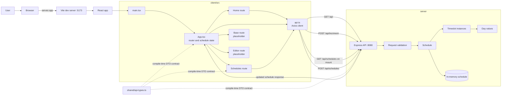

# Wiskie

Wiskie is a React client and an Express API for viewing and adding schedule
timeslots. The `client`, `server`, and `shared` directories are separate parts
of one application; the client and server each have their own package setup.

## Architecture



### Current request flow

- `main.tsx` mounts the React app. `App.tsx` defines the routes and fetches the
  initial schedule and greeting data when it mounts.
- The home page displays the greeting and has a demo increment request.
- The schedules page displays the schedule and posts new timeslots. After a
  successful post, the server returns the updated schedule and the client
  replaces its schedule state.
- `client/src/api.ts` owns the Axios instance and endpoint paths. Set
  `VITE_API_BASE_URL` to override its default API origin of
  `http://localhost:8080`.
- The API validates new timeslot requests, converts them to `Day` and
  `Timeslot` domain objects, and stores them in a `Schedule`.
- `shared/api-types.ts` describes the JSON shapes used on both sides, including
  the stricter `CreateTimeslotDto` required by the create endpoint. These
  TypeScript types do not validate network data at runtime.

## Current gaps

- Schedules exist only in server memory. Restarting the server resets them to
  the sample timeslot.
- The server CORS configuration is restricted to the Vite development origin;
  deployments will need an explicit allowed-origin configuration.
- `Base` and `Editor` are placeholder pages. The increment and greeting
  endpoints are demo functionality rather than schedule features.
- The server warns about overlapping timeslots but still adds them. The
  product behavior for conflicts has not been chosen yet.

These are the current implementation boundaries, not promises about the final
design. The client API boundary is now centralized; decide the desired schedule
persistence and overlap behavior before building out the editor.

## Run locally

Install dependencies in both packages, then run each development server in a
separate terminal:

```sh
cd server
npm install
npm run dev
```

```sh
cd client
npm install
npm run dev
```

The client runs on `http://localhost:5173` and the API on
`http://localhost:8080`.
